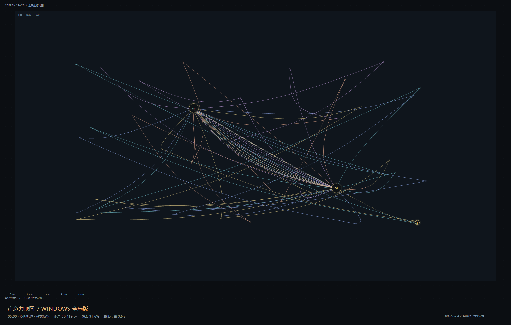

# 注意力地图 / Attention Atlas

把鼠标移动、停留与点击绘成一张可回放、可导出的地图。本仓库包含 Windows 全局记录器、网页版和单文件离线版，整理于 2026 年 10 月 13 日。

## 直接使用

- **Windows 最新版**：下载根目录的 `注意力地图-Windows版-时长比例版.exe` 后双击运行。可在其他应用中记录鼠标轨迹，关闭主窗口后收起到托盘。结束使用时从托盘菜单退出。
- **离线网页版**：下载 `注意力地图-离线版.html`，用浏览器打开。无需安装，仅记录当前页面。
- **网页源码**：在 `attention-map` 目录运行 `node server.mjs`，访问 http://127.0.0.1:4173 。无需安装项目依赖。

## 最新功能

- 路径每分钟变色，支持 1～60 分钟的 Windows 记录。
- 相近点击聚合为圆点，圆内数字表示实际点击次数。
- Windows 停留圆的面积与停留时长成正比，长停留统一缩放并保留面积比例。
- 路径、热力底图和点击标记可独立切换；支持回放、PNG 导出与本地保存。
- Windows 支持 JSON 记录和 CSV 导出；网页自动保存到当前浏览器。

## 源码与构建

```text
attention-map/          网页源码、静态页面与测试
attention-map-desktop/  Windows C# 源码、manifest、构建和自检脚本
```

需要 Node.js 时，在 `attention-map` 中运行：

```powershell
node --test tests/engine.test.cjs
node build-offline.mjs
```

Windows 使用系统 .NET Framework C# 编译器，无 NuGet 依赖。在仓库根目录运行：

```powershell
powershell -ExecutionPolicy Bypass -File .\attention-map-desktop\build.ps1 -OutputPath .\注意力地图-Windows版-时长比例版.exe
powershell -ExecutionPolicy Bypass -File .\attention-map-desktop\test.ps1 -ExePath .\注意力地图-Windows版-时长比例版.exe
```

网页浏览器检查使用 Playwright 与 Edge：安装 Playwright 后运行 `node attention-map/tests/browser-check.cjs`。

详细说明见 `attention-map/README.md`、`attention-map-desktop/README.md`、`attention-map-desktop/dwell-update.md` 和根目录的使用指南。Windows 构建脚本不指定输出路径时生成 `注意力地图-Windows版.exe`，内容来自当前源码。

## 数据说明

程序不上传鼠标记录。Windows 将记录保存在程序旁的 `注意力地图记录` 文件夹；网页使用当前浏览器的 localStorage。仓库不包含个人使用记录。鼠标轨迹不是眼动追踪，也不是注意力的科学测量。

## 预览

以下预览使用模拟数据。


